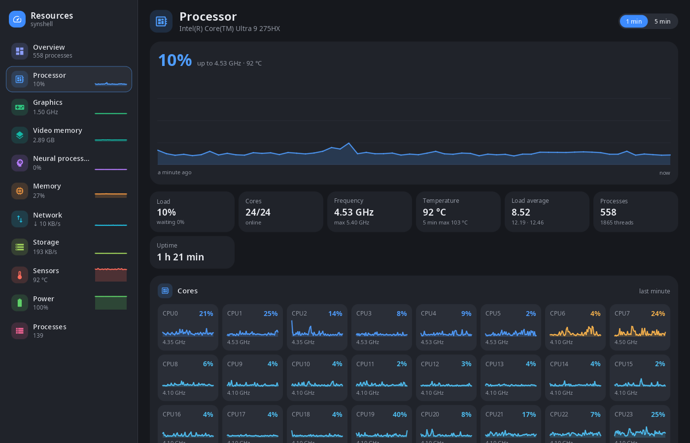
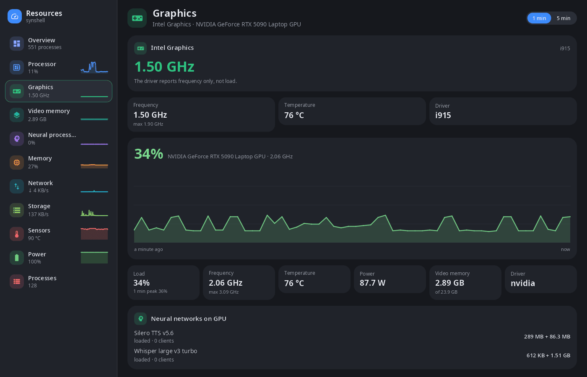
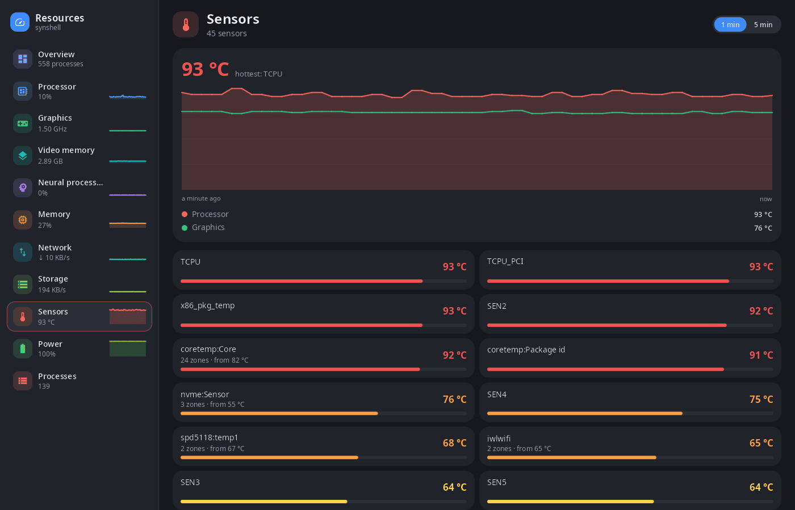
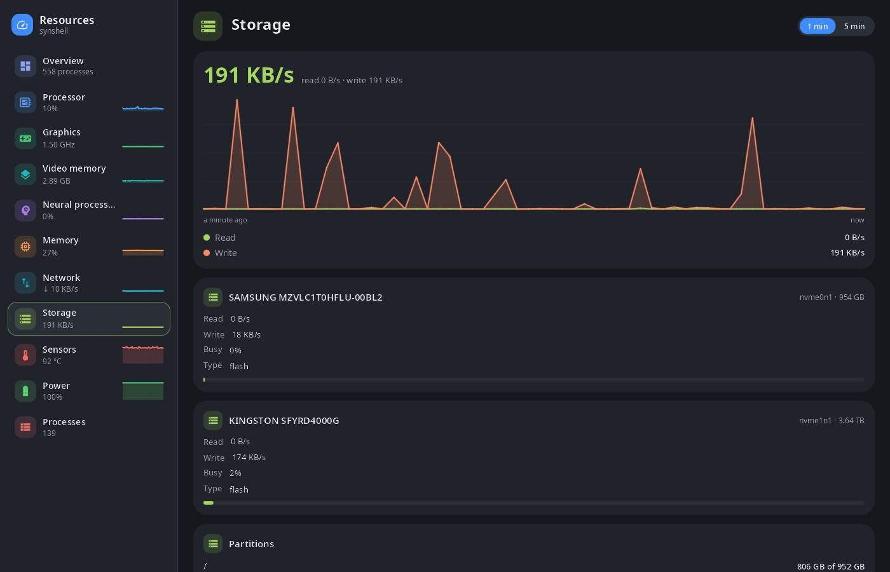

<div align="center">

# syn-systeminfo

**System monitor for the synshell desktop — processor, graphics and video memory, NPU, memory, network, storage, sensors, power and processes.**

[Русский](README.ru.md) · [Website](https://alexeyev.dev/synshell/) · [AUR: syn-systeminfo-bin](https://aur.archlinux.org/packages/syn-systeminfo-bin) · [AUR: syn-systeminfo-git](https://aur.archlinux.org/packages/syn-systeminfo-git)



</div>

## Features

- **Overview** — every resource as a tile with a live graph, system summary (processor, memory, graphics, NPU, kernel, uptime, load average) and the most active processes.
- **Processor** — total load with a 1- or 5-minute graph, frequency, temperature, load average, and a graph for every core.
- **Graphics and video memory** — load, frequency, temperature, power draw and video memory of every GPU (Intel, AMD, NVIDIA), and the neural networks of the synaptix service loaded on the GPU.
- **NPU** — load and memory of the neural processor (Intel and other `accel` devices, Qualcomm).
- **Memory** — applications, shared, kernel, file cache and free in one bar, swap, pending writes, memory pressure (PSI), the largest memory users.
- **Network** — speed of every interface, totals since boot, addresses.
- **Storage** — read and write speed of every drive, partitions and free space.
- **Sensors** — all temperature sensors, the hottest one in the graph.
- **Power** — battery charge and power draw.
- **Processes** — applications (windows) and processes: search by name, command, PID or user, sorting, “Close” (a window is asked to close, a process gets SIGTERM) and “Kill” (SIGKILL).
- **One window** — starting it again (for example, a tap on the desktop widget) opens the requested page in the window that is already open.
- **Computer and phone** — a sidebar with pages on a wide window, a page at a time on a narrow one.
- **14 languages** — the UI follows the system or the language chosen in settings.

| Graphics | Sensors | Storage |
|---|---|---|
|  |  |  |

## Install

**Arch Linux (AUR)** — x86_64 and aarch64:

```sh
yay -S syn-systeminfo-bin      # prebuilt
yay -S syn-systeminfo-git      # built from source
```

Depends on `synshell-core`. The whole desktop: `yay -S synshell-bin`. **From source:** `cargo build --release -p syn-systeminfo` in the [synshell](../../README.md) repository.

## Command line

```sh
syn-systeminfo                  # overview
syn-systeminfo gpu              # open a page: cpu, gpu, vram, npu, memory, network, disk, sensors, battery, processes
syn-systeminfo --list-pages     # page ids and titles
syn-systeminfo --screenshot out.png --page cpu --size 1400x900 --scale 1 --history 60
                                # render a page to PNG without a window, after collecting 60 s of graphs
```

## Part of synshell

syn-systeminfo is one of the applications of [synshell](../../README.md) — a Wayland desktop environment in Rust for computers and phones, built on the [syngui](https://github.com/VitaminDB/syngui) UI framework.

## License

GPL-3.0-only
