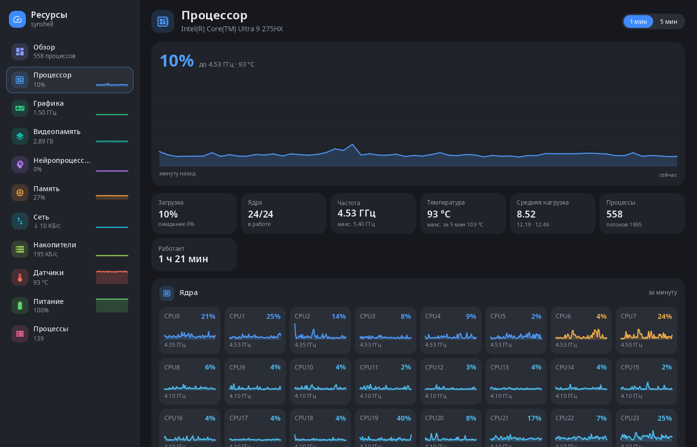
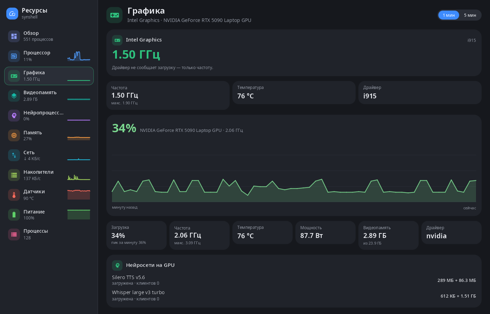
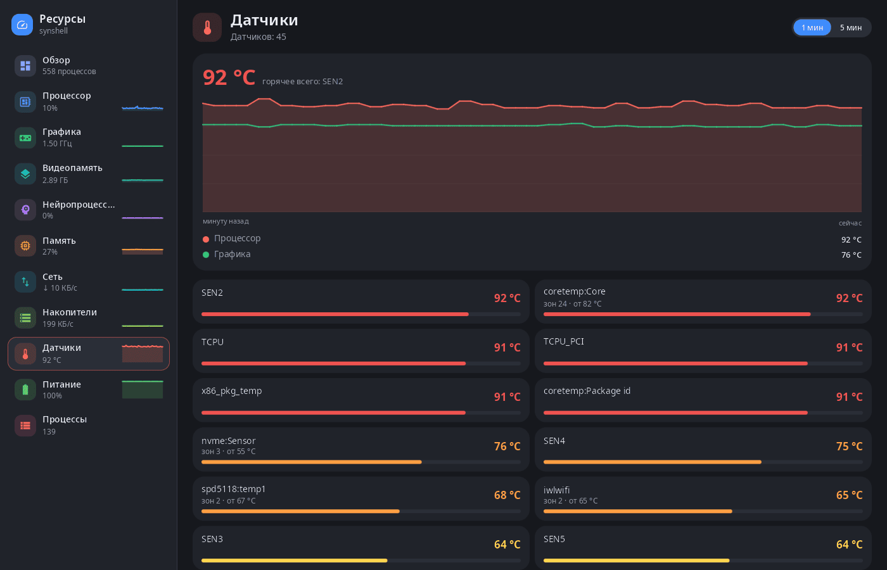
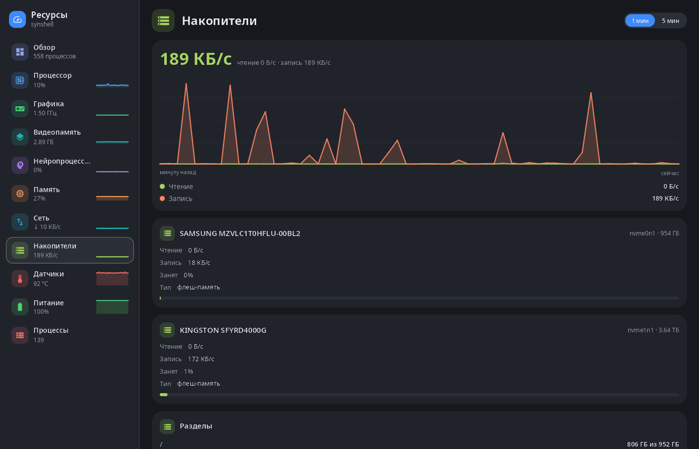

<div align="center">

# syn-systeminfo

**Монитор ресурсов рабочего стола synshell — процессор, графика и видеопамять, нейропроцессор, память, сеть, накопители, датчики, питание и процессы.**

[English](README.md) · [Сайт](https://alexeyev.dev/ru/synshell/) · [AUR: syn-systeminfo-bin](https://aur.archlinux.org/packages/syn-systeminfo-bin) · [AUR: syn-systeminfo-git](https://aur.archlinux.org/packages/syn-systeminfo-git)



</div>

## Возможности

- **Обзор** — каждый ресурс плиткой с живым графиком, сводка о системе (процессор, память, графика, NPU, ядро, время работы, средняя загрузка) и самые активные процессы.
- **Процессор** — общая загрузка с графиком за 1 или 5 минут, частота, температура, средняя загрузка и график каждого ядра.
- **Графика и видеопамять** — загрузка, частота, температура, мощность и видеопамять каждой видеокарты (Intel, AMD, NVIDIA), а также нейросети службы synaptix, загруженные на видеокарту.
- **Нейропроцессор** — загрузка и память NPU (Intel и другие устройства `accel`, Qualcomm).
- **Память** — программы, общая память, ядро, файловый кэш и свободная одной полосой, подкачка, ожидающие записи, нехватка памяти (PSI), самые большие потребители.
- **Сеть** — скорость каждого интерфейса, объём с момента загрузки, адреса.
- **Накопители** — скорость чтения и записи каждого диска, разделы и свободное место.
- **Датчики** — все датчики температуры, самый горячий — на графике.
- **Питание** — заряд аккумулятора и мощность.
- **Процессы** — приложения (окна) и процессы: поиск по имени, команде, PID или пользователю, сортировка, «Завершить» (окну — просьба закрыться, процессу — SIGTERM) и «Убить» (SIGKILL).
- **Одно окно** — повторный запуск (например, касание виджета на рабочем столе) открывает нужную страницу в уже открытом окне.
- **Компьютер и телефон** — боковая панель со страницами в широком окне, страницы по одной в узком.
- **14 языков** — как в системе или язык, выбранный в настройках.

| Графика | Датчики | Накопители |
|---|---|---|
|  |  |  |

## Установка

**Arch Linux (AUR)** — x86_64 и aarch64:

```sh
yay -S syn-systeminfo-bin      # готовые бинарники
yay -S syn-systeminfo-git      # сборка из исходников
```

Зависит от `synshell-core`. Весь рабочий стол: `yay -S synshell-bin`. **Из исходников:** `cargo build --release -p syn-systeminfo` в репозитории [synshell](../../README.md).

## Командная строка

```sh
syn-systeminfo                  # обзор
syn-systeminfo gpu              # открыть страницу: cpu, gpu, vram, npu, memory, network, disk, sensors, battery, processes
syn-systeminfo --list-pages     # идентификаторы и названия страниц
syn-systeminfo --screenshot out.png --page cpu --size 1400x900 --scale 1 --history 60
                                # страница в PNG без окна, после 60 с замеров для графиков
```

## Часть synshell

syn-systeminfo — одно из приложений [synshell](../../README.md): окружения рабочего стола для Wayland на Rust для компьютеров и телефонов, на UI-фреймворке [syngui](https://github.com/VitaminDB/syngui).

## Лицензия

GPL-3.0-only
