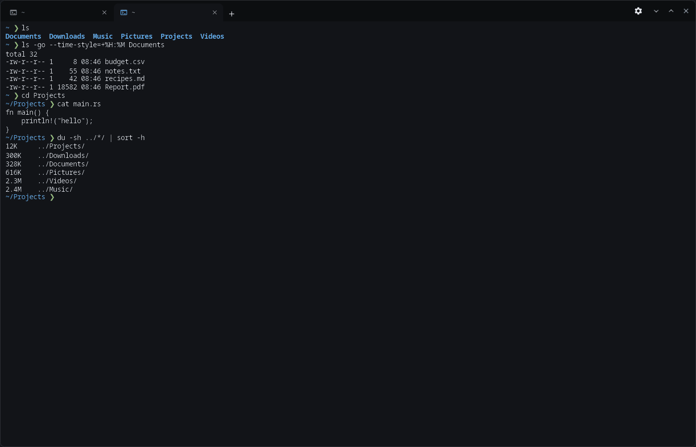
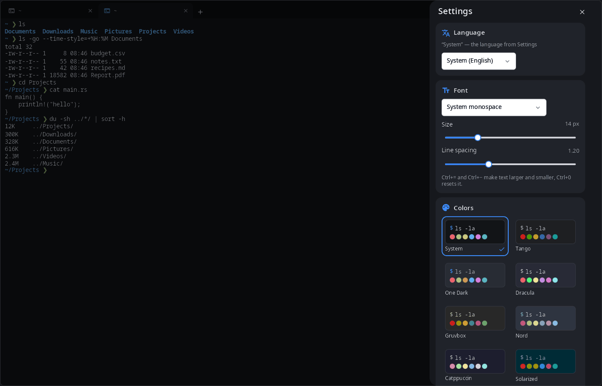

<div align="center">

# syn-terminal

**Terminal for the synshell desktop — tabs in the title bar, color schemes, font settings; on a phone, a row of keys the on-screen keyboard lacks.**

[Русский](README.ru.md) · [Website](https://alexeyev.dev/synshell/syn-terminal/) · [AUR: synshell-core-bin](https://aur.archlinux.org/packages/synshell-core-bin) · [AUR: synshell-core-git](https://aur.archlinux.org/packages/synshell-core-git)



</div>

## Features

- **Tabs in the title bar** — the tab title follows the current folder; Ctrl+Shift+T new tab (in the folder of the current one, if enabled), Ctrl+Shift+W close, Ctrl+Tab and Ctrl+PageUp/PageDown switch, Ctrl+1…9 by number, Ctrl+Shift+PageUp/PageDown move the tab; Ctrl+Shift+N new window, Ctrl+, settings.
- **Color schemes** — “System” (built from the synshell palette and accent, follows the theme), Tango, One Dark, Dracula, Gruvbox, Nord, Catppuccin, Solarized, Solarized Light, GitHub Light.
- **Font** — any monospace font, size and line spacing; Ctrl+= and Ctrl+− make text larger and smaller, Ctrl+0 resets.
- **Background opacity** from 50 to 100 %.
- **Shell and history** — the shell of new tabs (`$SHELL` by default), the number of scrollback lines.
- **Close confirmation** when a program is still running in a tab or window.
- **Copy and paste** — Ctrl+Shift+C / Ctrl+Shift+V.
- **Live theme** — the window follows `config.toml` and theme changes without a restart.
- **Phone** — tabs under the compositor frame and a row of extra keys at the bottom.
- **14 languages** — the UI follows the system or the language chosen in the terminal settings.

| Settings |
|---|
|  |

## Install

**Arch Linux (AUR)** — x86_64 and aarch64. syn-terminal is part of `synshell-core`, the base set of desktop programs (compositor, shell, settings, file manager, terminal, software center, screenshots):

```sh
yay -S synshell-core-bin      # prebuilt
yay -S synshell-core-git      # built from source
```

Settings are stored in `~/.config/synshell/terminal.toml`.

The whole desktop: `yay -S synshell-bin`. **From source:** `cargo build --release -p syn-terminal` in the [synshell](../../README.md) repository.

## Command line

```sh
syn-terminal                                  # shell in the current folder
syn-terminal --working-directory ~/Projects   # start in a folder (also -d, -w)
syn-terminal -e htop                          # run a command (also -x, --)
syn-terminal -e 'make && ./run'               # one string with spaces runs through sh -c
```

`--title`, `--class`, `--app-id` are accepted for compatibility with other terminals.

## Part of synshell

syn-terminal is one of the applications of [synshell](../../README.md) — a Wayland desktop environment in Rust for computers and phones, built on the [syngui](https://github.com/VitaminDB/syngui) UI framework.

## License

GPL-3.0-only
