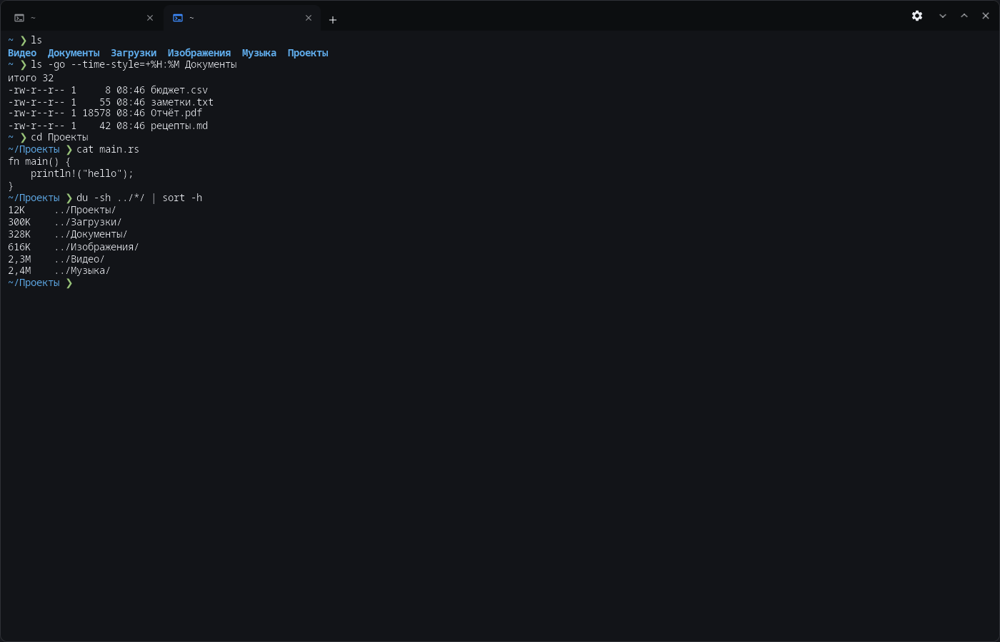
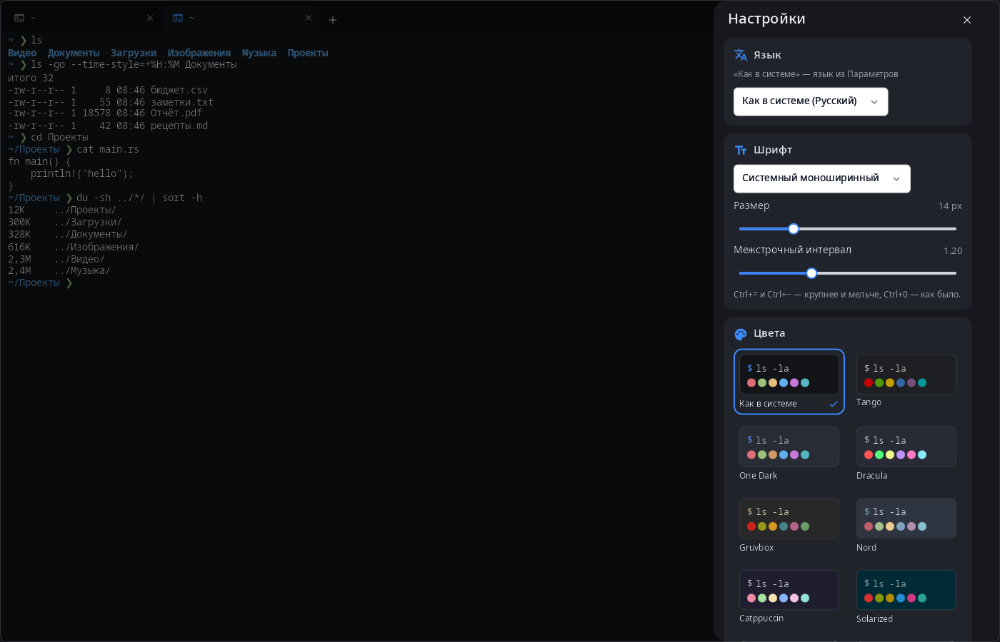

<div align="center">

# syn-terminal

**Терминал рабочего стола synshell — вкладки в заголовке окна, схемы цветов, настройка шрифта; на телефоне — ряд клавиш, которых нет на экранной клавиатуре.**

[English](README.md) · [Сайт](https://alexeyev.dev/ru/synshell/syn-terminal/) · [AUR: synshell-core-bin](https://aur.archlinux.org/packages/synshell-core-bin) · [AUR: synshell-core-git](https://aur.archlinux.org/packages/synshell-core-git)



</div>

## Возможности

- **Вкладки в заголовке окна** — подпись вкладки следует за текущей папкой; Ctrl+Shift+T — новая вкладка (если включено — в папке текущей), Ctrl+Shift+W — закрыть, Ctrl+Tab и Ctrl+PageUp/PageDown — соседняя, Ctrl+1…9 — по номеру, Ctrl+Shift+PageUp/PageDown — переставить; Ctrl+Shift+N — новое окно, Ctrl+, — настройки.
- **Схемы цветов** — «Как в системе» (из палитры и акцента synshell, следует за темой), Tango, One Dark, Dracula, Gruvbox, Nord, Catppuccin, Solarized, Solarized Light, GitHub Light.
- **Шрифт** — любой моноширинный шрифт, размер и межстрочный интервал; Ctrl+= и Ctrl+− — крупнее и мельче, Ctrl+0 — как было.
- **Непрозрачность фона** от 50 до 100 %.
- **Оболочка и история** — оболочка новых вкладок (по умолчанию `$SHELL`), число строк истории.
- **Вопрос перед закрытием**, если во вкладке или окне ещё работает программа.
- **Копирование и вставка** — Ctrl+Shift+C / Ctrl+Shift+V.
- **Живая тема** — окно следует за `config.toml` и сменой темы без перезапуска.
- **Телефон** — вкладки под рамкой композитора и ряд дополнительных клавиш внизу.
- **14 языков** — как в системе или язык, выбранный в настройках терминала.

| Настройки |
|---|
|  |

## Установка

**Arch Linux (AUR)** — x86_64 и aarch64. syn-terminal входит в пакет `synshell-core` — базовый набор программ рабочего стола (композитор, оболочка, параметры, проводник, терминал, установка программ, снимки экрана):

```sh
yay -S synshell-core-bin      # готовые бинарники
yay -S synshell-core-git      # сборка из исходников
```

Настройки хранятся в `~/.config/synshell/terminal.toml`.

Весь рабочий стол: `yay -S synshell-bin`. **Из исходников:** `cargo build --release -p syn-terminal` в репозитории [synshell](../../README.md).

## Командная строка

```sh
syn-terminal                                  # оболочка в текущей папке
syn-terminal --working-directory ~/Проекты    # запуск в папке (или -d, -w)
syn-terminal -e htop                          # выполнить команду (или -x, --)
syn-terminal -e 'make && ./run'               # одна строка с пробелами выполняется через sh -c
```

Для совместимости с другими терминалами принимаются `--title`, `--class`, `--app-id`.

## Часть synshell

syn-terminal — одно из приложений [synshell](../../README.md): окружения рабочего стола для Wayland на Rust для компьютеров и телефонов, на UI-фреймворке [syngui](https://github.com/VitaminDB/syngui).

## Лицензия

GPL-3.0-only
