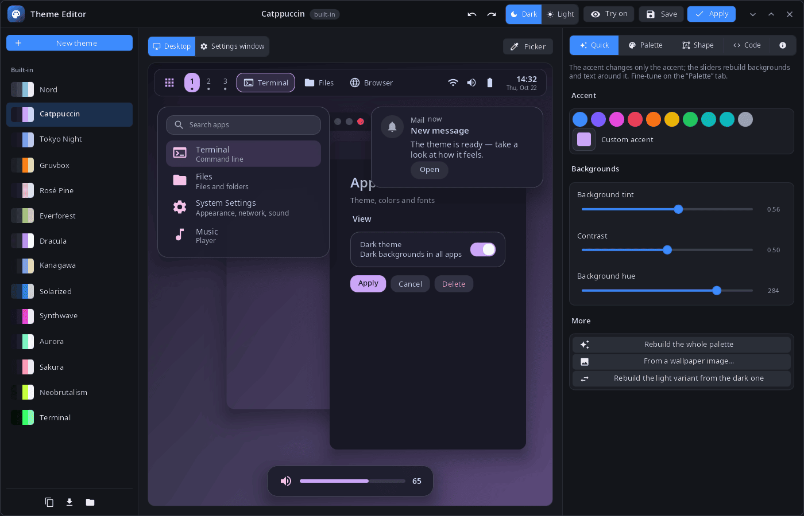
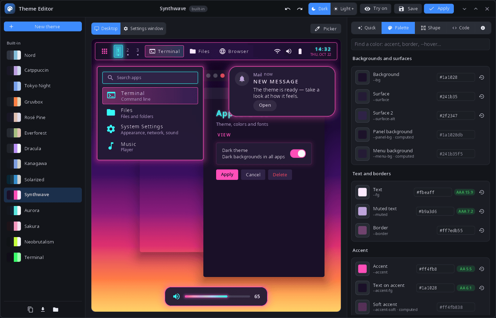
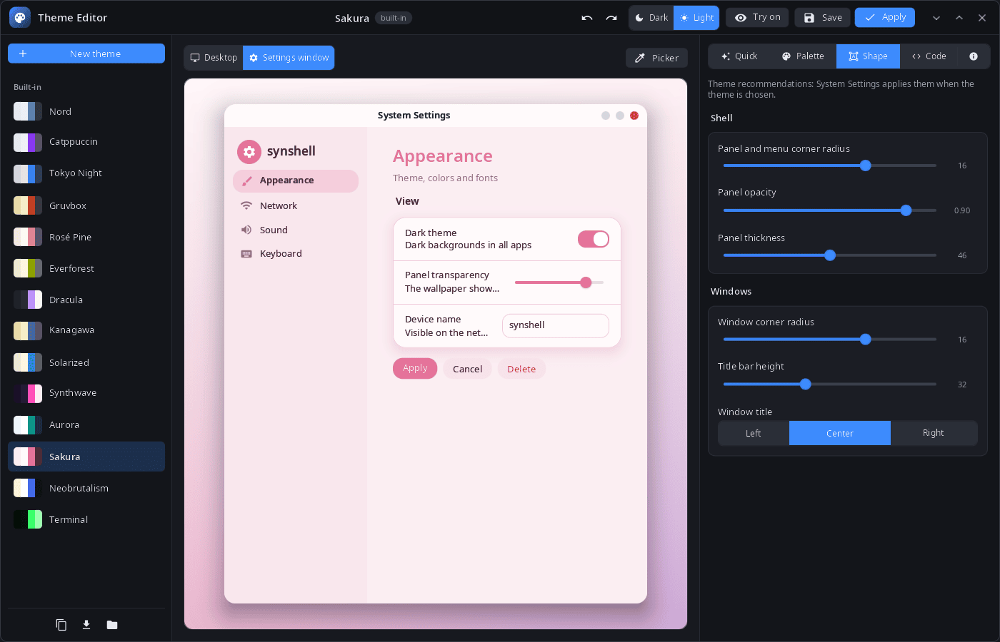
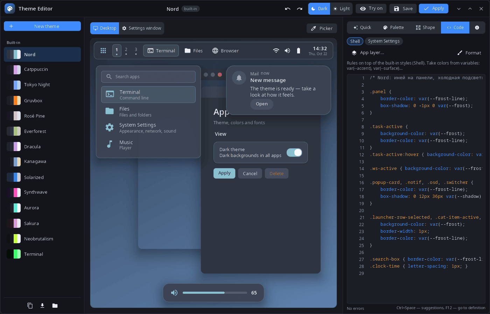

<div align="center">

# syn-themeeditor

**Theme editor for the synshell desktop — palette, shape and MSS styles with a live preview of the desktop and System Settings.**

[Русский](README.ru.md) · [Website](https://alexeyev.dev/synshell/) · [AUR: syn-themeeditor-bin](https://aur.archlinux.org/packages/syn-themeeditor-bin) · [AUR: syn-themeeditor-git](https://aur.archlinux.org/packages/syn-themeeditor-git)



</div>

## Features

- **Themes** — 14 built-in themes (Nord, Catppuccin, Tokyo Night, Gruvbox, Rosé Pine, Everforest, Dracula, Kanagawa, Solarized, Synthwave, Aurora, Sakura, Neobrutalism, Terminal) and your own; a new theme from any of them; a changed built-in theme is saved as your copy, “Delete” brings the original back.
- **Live preview** — a desktop with the panel, launcher, notification and volume indicator, or the System Settings window, drawn with the real styles of the shell and Settings; dark and light variants.
- **Try on** — while the editor is open, the whole system shows the draft; closing the editor puts the current theme back.
- **Quick** — accent presets and a custom accent; backgrounds rebuilt from tint, contrast and hue; the whole palette from a wallpaper image; the light variant from the dark one and back.
- **Palette** — every color token with search, contrast against the background (AA/AAA) and reset to default; the picker shows which tokens an element of the preview uses.
- **Shape** — corner radius and opacity of panels and menus, panel thickness, window corners, title bar height and title alignment.
- **Code** — MSS layers for the shell, System Settings and any app, with completion (Ctrl+Space), go to definition (F12), error checking and formatting.
- **Files** — export and import of `.syntheme`; themes live in `~/.config/synshell/themes/<id>/` (`theme.toml` and MSS layers); undo and redo.
- **14 languages** — the UI follows the language of the system or the one chosen in System Settings.

| Palette | Shape | Code |
|---|---|---|
|  |  |  |

## Install

**Arch Linux (AUR)** — x86_64 and aarch64:

```sh
yay -S syn-themeeditor-bin      # prebuilt
yay -S syn-themeeditor-git      # built from source
```

Depends on `synshell-core`. Part of the `synshell` metapackage: `yay -S synshell-bin` installs the whole desktop. **From source:** `cargo build --release -p syn-themeeditor` in the [synshell](../../README.md) repository.

## Command line

```sh
syn-themeeditor                         # the current system theme
syn-themeeditor dracula                 # open a theme by id
syn-themeeditor --new nord              # new theme based on Nord
syn-themeeditor --import my.syntheme    # import a theme file
syn-themeeditor --mss-context ctx.json  # variables, classes and animations for the MSS language server
syn-themeeditor nord --screenshot shot.png --size 1400x900 --mode palette --scene settings --light
                                        # window snapshot (modes: quick, palette, shape, code, about)
```

## Part of synshell

syn-themeeditor is one of the applications of [synshell](../../README.md) — a Wayland desktop environment in Rust for computers and phones, built on the [syngui](https://github.com/VitaminDB/syngui) UI framework.

## License

GPL-3.0-only
