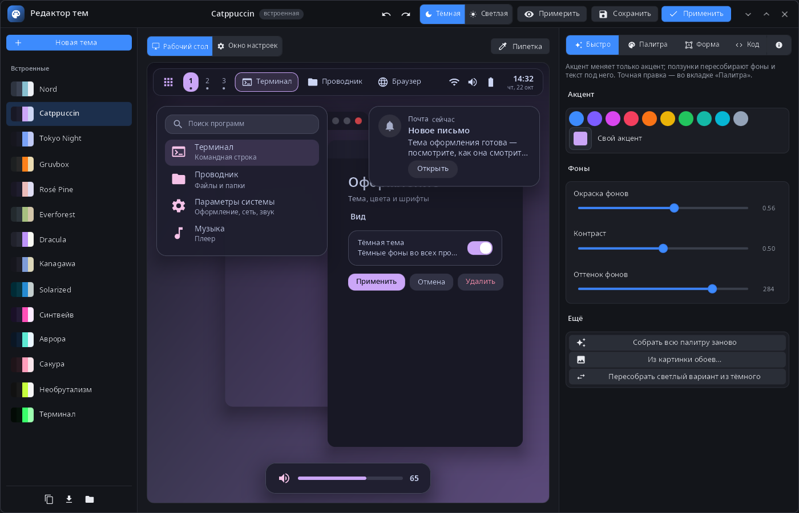
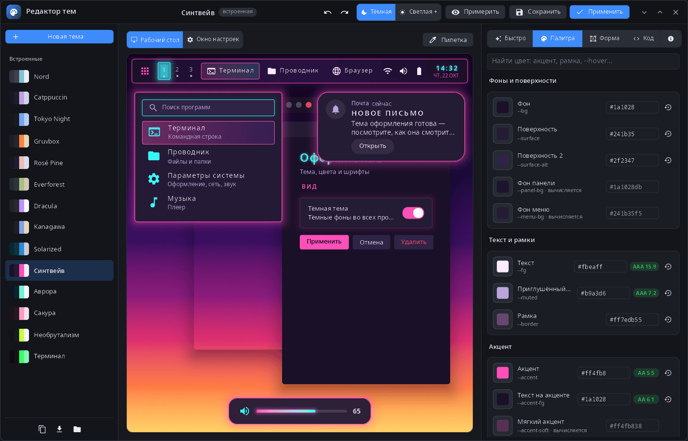
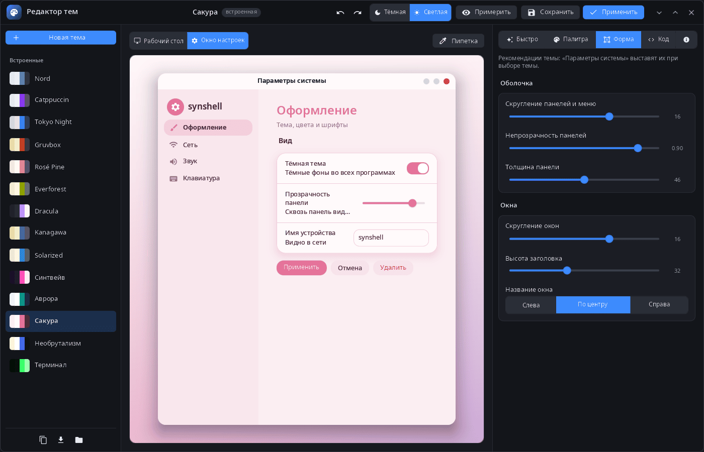
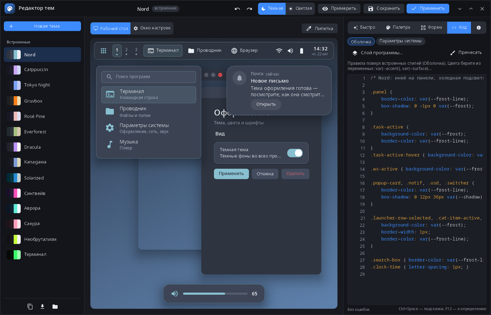

<div align="center">

# syn-themeeditor

**Редактор тем рабочего стола synshell — палитра, форма и стили MSS с живым просмотром рабочего стола и «Параметров системы».**

[English](README.md) · [Сайт](https://alexeyev.dev/ru/synshell/) · [AUR: syn-themeeditor-bin](https://aur.archlinux.org/packages/syn-themeeditor-bin) · [AUR: syn-themeeditor-git](https://aur.archlinux.org/packages/syn-themeeditor-git)



</div>

## Возможности

- **Темы** — 14 встроенных (Nord, Catppuccin, Tokyo Night, Gruvbox, Rosé Pine, Everforest, Dracula, Kanagawa, Solarized, Синтвейв, Аврора, Сакура, Необрутализм, Терминал) и свои; новая тема на основе любой; изменённая встроенная сохраняется вашей копией, «Удалить» возвращает исходную.
- **Живой просмотр** — рабочий стол с панелью, меню программ, уведомлением и индикатором громкости или окно «Параметров системы» с настоящими стилями оболочки и параметров; тёмный и светлый варианты.
- **Примерка** — пока редактор открыт, вся система показывает черновик; при закрытии редактора возвращается текущая тема.
- **Быстро** — готовые акценты и свой; фоны пересобираются по окраске, контрасту и оттенку; вся палитра — по картинке обоев; светлый вариант из тёмного и наоборот.
- **Палитра** — все цвета темы с поиском, контрастом к фону (AA/AAA) и сбросом к значению по умолчанию; пипетка показывает, какие цвета у элемента просмотра.
- **Форма** — скругление и непрозрачность панелей и меню, толщина панели, скругление окон, высота и выравнивание заголовка.
- **Код** — слои MSS для оболочки, «Параметров системы» и любой программы: подсказки (Ctrl+Space), переход к определению (F12), проверка ошибок и форматирование.
- **Файлы** — экспорт и импорт `.syntheme`; темы лежат в `~/.config/synshell/themes/<id>/` (`theme.toml` и слои MSS); отмена и повтор правок.
- **14 языков** — как в системе или язык, выбранный в «Параметрах системы».

| Палитра | Форма | Код |
|---|---|---|
|  |  |  |

## Установка

**Arch Linux (AUR)** — x86_64 и aarch64:

```sh
yay -S syn-themeeditor-bin      # готовые бинарники
yay -S syn-themeeditor-git      # сборка из исходников
```

Зависит от `synshell-core`. Входит в метапакет `synshell`: `yay -S synshell-bin` ставит весь рабочий стол. **Из исходников:** `cargo build --release -p syn-themeeditor` в репозитории [synshell](../../README.md).

## Командная строка

```sh
syn-themeeditor                         # текущая тема системы
syn-themeeditor dracula                 # открыть тему по id
syn-themeeditor --new nord              # новая тема на основе Nord
syn-themeeditor --import my.syntheme    # импорт файла темы
syn-themeeditor --mss-context ctx.json  # переменные, классы и анимации для языкового сервера MSS
syn-themeeditor nord --screenshot shot.png --size 1400x900 --mode palette --scene settings --light
                                        # снимок окна (вкладки: quick, palette, shape, code, about)
```

## Часть synshell

syn-themeeditor — одно из приложений [synshell](../../README.md): окружения рабочего стола для Wayland на Rust для компьютеров и телефонов, на UI-фреймворке [syngui](https://github.com/VitaminDB/syngui).

## Лицензия

GPL-3.0-only
