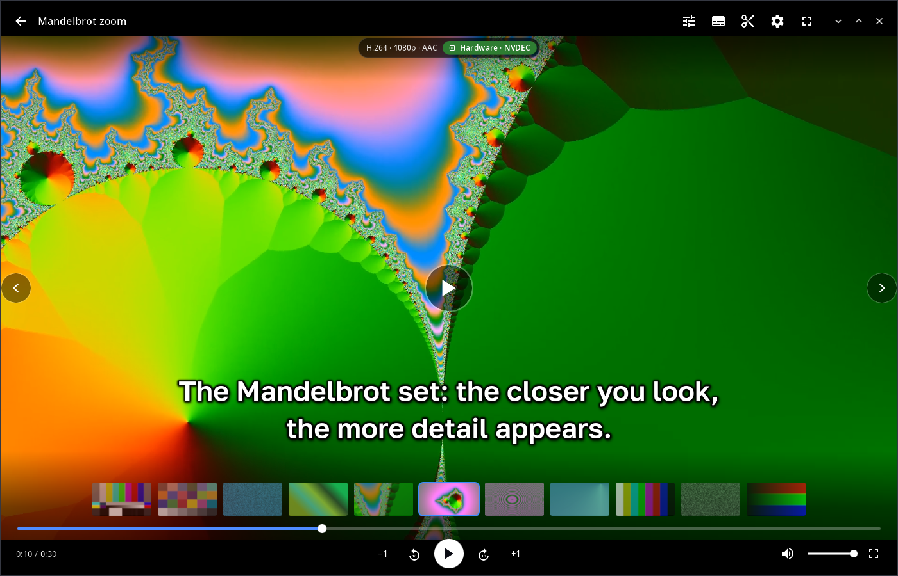
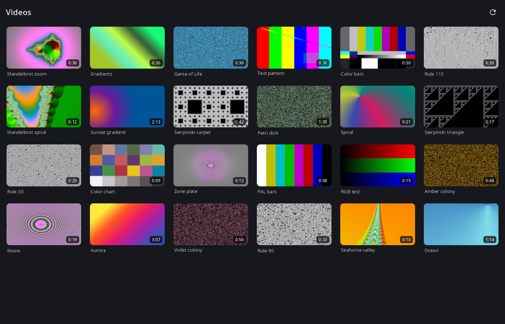
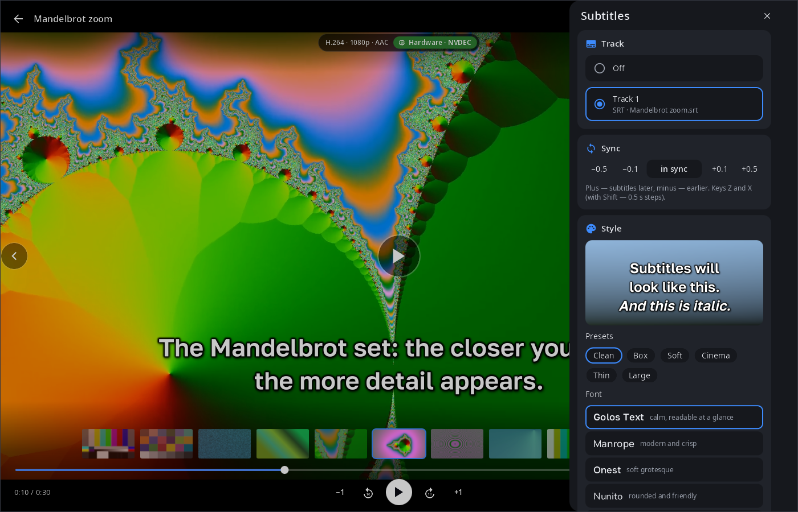
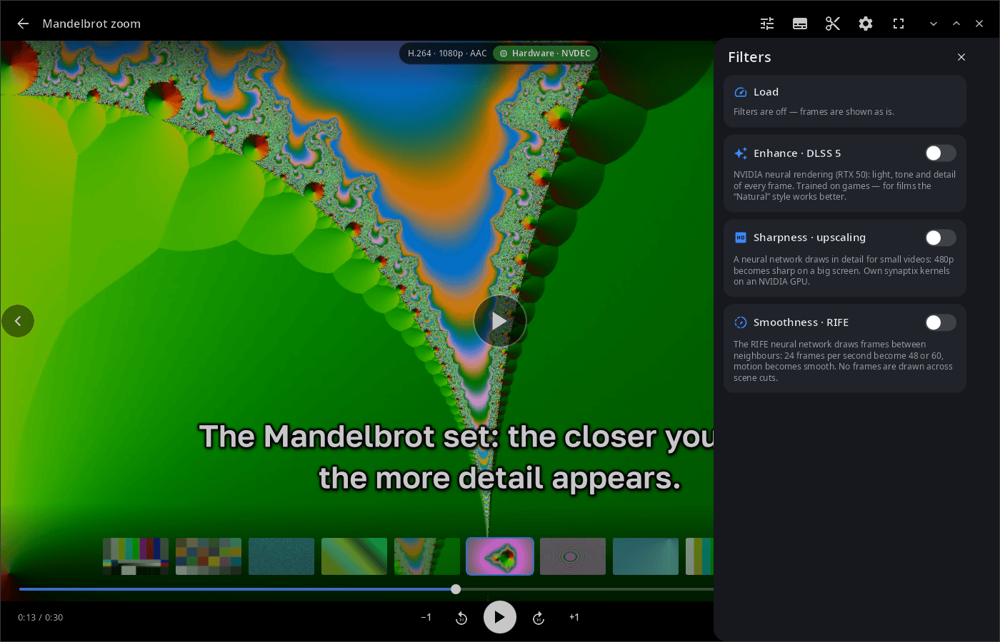

<div align="center">

# syn-video-player

**Video player for the synshell desktop — hardware decoding, subtitles with full styling, a simple cut-and-join editor and neural filters.**

[Русский](README.ru.md) · [Website](https://alexeyev.dev/synshell/syn-video-player/) · [AUR: syn-video-player-bin](https://aur.archlinux.org/packages/syn-video-player-bin) · [AUR: syn-video-player-git](https://aur.archlinux.org/packages/syn-video-player-git)



</div>

## Features

- **Library** — videos from “Videos” and “Downloads” (two levels deep), newest first, with thumbnails and durations; the grid adapts from a phone in portrait to a wide monitor.
- **Hardware decoding** — VAAPI and NVDEC on computers, the SoC V4L2 decoder on phones, software ffmpeg otherwise; frames go to the screen as YUV without extra copies where possible. A chip in the header shows the codec, resolution and how it is decoded. Any format ffmpeg reads, local files or network URLs.
- **Controls** — tap for the panel and pause, double tap at the edges to seek by 5/10/15/30 s, in the centre for fullscreen; keyboard: Space/K, J/L, arrows, 0–9, M, F, Home.
- **Folder browsing** — previous/next video of the same folder, a thumbnail strip above the seek bar, optional autoplay of the next video, repeat, resume from where you stopped.
- **Audio tracks** — choose the dub; the choice carries over to the next episode (same track name, otherwise the same language).
- **Subtitles** — embedded tracks (text and PGS) and files next to the video (`Movie.srt`, `Movie.rus.ass`, `Subs/…`) with encoding detection; timing shift, presets, font, size, colours, outline, shadow, box, position and animations with a live preview; keys C, Z/X.
- **Editor** — cut at the playhead, remove and restore pieces, reorder, append other videos; save precisely (H.264 + AAC re-encode) or fast without re-encoding.
- **Neural filters** (NVIDIA) — DLSS 5 enhancement (the `syn-wine-dlss5` helper), super-resolution and RIFE frame interpolation on synaptix models (x86_64); comparison with the original frame along a draggable line, and how much of the frame time the filters take.
- **HDR** — HDR video is tone-mapped for SDR screens and passed through as is when the monitor is in HDR mode under synwm.
- **14 languages** — the UI follows the system or the language chosen in synshell.

| Library | Subtitles | Filters |
|---|---|---|
|  |  |  |

## Install

**Arch Linux (AUR)** — x86_64 and aarch64:

```sh
yay -S syn-video-player-bin      # prebuilt
yay -S syn-video-player-git      # built from source
```

Depends on `ffmpeg`. Neural filters need an NVIDIA card: DLSS 5 — the `syn-wine-dlss5` helper, super-resolution and RIFE — `.syn` models in the `vfx` folder of the synaptix model library.

The player is part of the `synshell` metapackage — the whole desktop: `yay -S synshell-bin`. **From source:** `cargo build --release -p syn-video-player` in the [synshell](../../README.md) repository.

## Command line

```sh
syn-video-player                                # library
syn-video-player movie.mkv                      # open a file or a URL
syn-video-player --hw none movie.mkv            # decoder: auto|none|v4l2|vaapi|nvdec|vulkan
syn-video-player --bench movie.mkv              # decode at full speed without a window, print fps
syn-video-player --screenshot shot.png --page player --size 1400x900   # render the UI to PNG
syn-video-player --help
```

## Part of synshell

syn-video-player is one of the applications of [synshell](../../README.md) — a Wayland desktop environment in Rust for computers and phones, built on the [syngui](https://github.com/VitaminDB/syngui) UI framework.

## License

GPL-3.0-only
