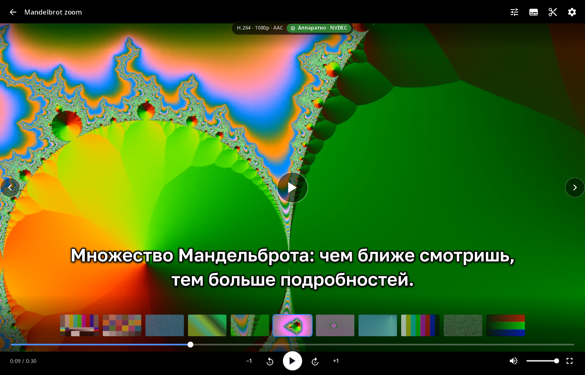
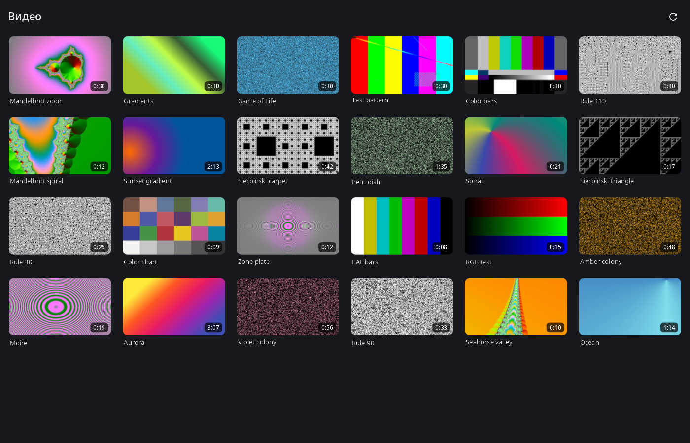
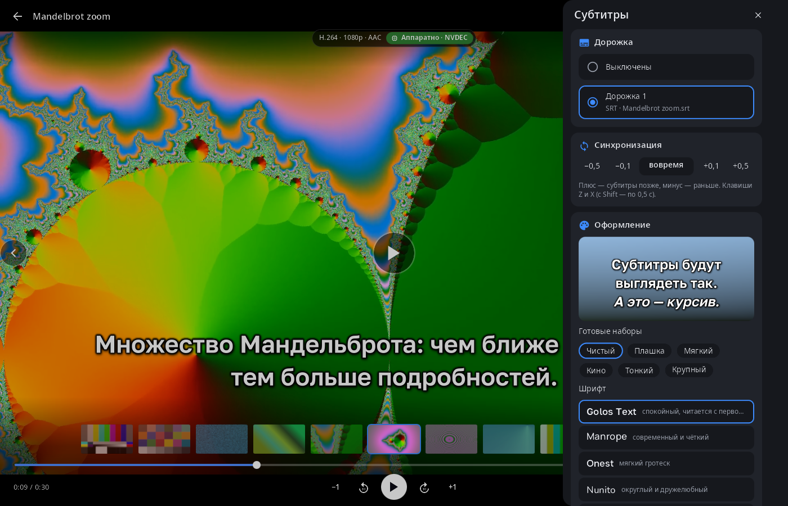
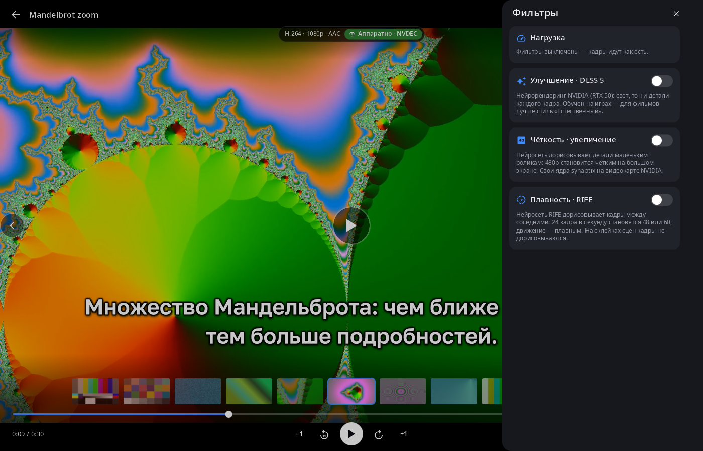

<div align="center">

# syn-video-player

**Видеоплеер рабочего стола synshell — аппаратное декодирование, субтитры с полным оформлением, простой монтаж и нейрофильтры.**

[English](README.md) · [Сайт](https://alexeyev.dev/ru/syndesktop/) · [AUR: syn-video-player-bin](https://aur.archlinux.org/packages/syn-video-player-bin) · [AUR: syn-video-player-git](https://aur.archlinux.org/packages/syn-video-player-git)



</div>

## Возможности

- **Библиотека** — видео из «Видео» и «Загрузок» (на два уровня вглубь), новые сверху, с миниатюрами и длительностью; сетка подстраивается от телефона в портрете до широкого монитора.
- **Аппаратное декодирование** — VAAPI и NVDEC на компьютерах, V4L2-декодер SoC на телефонах, иначе программный ffmpeg; где можно, кадры идут на экран в YUV без лишних копий. Чип в шапке показывает кодек, разрешение и способ декодирования. Любой формат, который читает ffmpeg, — файлы и сетевые адреса.
- **Управление** — тап: панель и пауза, двойной тап по краям — перемотка на 5/10/15/30 с, по центру — во весь экран; клавиши: пробел/K, J/L, стрелки, 0–9, M, F, Home.
- **Листание папки** — предыдущий и следующий ролик той же папки, лента миниатюр над шкалой перемотки, по желанию — следующий ролик сам, повтор, продолжение с места остановки.
- **Звуковые дорожки** — выбор озвучки; следующая серия откроется с ней же (то же название дорожки, иначе тот же язык).
- **Субтитры** — встроенные дорожки (текст и PGS) и файлы рядом с роликом (`Фильм.srt`, `Фильм.rus.ass`, `Subs/…`) с определением кодировки; сдвиг по времени, готовые наборы, шрифт, размер, цвета, контур, тень, плашка, положение и анимации с живым образцом; клавиши C, Z/X.
- **Монтаж** — резать в точке воспроизведения, убирать и возвращать куски, переставлять, добавлять в конец другие ролики; сохранять точно (перекодирование в H.264 + AAC) или быстро, без перекодирования.
- **Нейрофильтры** (NVIDIA) — улучшение DLSS 5 (помощник `syn-wine-dlss5`), увеличение разрешения и промежуточные кадры RIFE на моделях synaptix (x86_64); сравнение с исходным кадром по черте, которую можно тянуть, и доля времени кадра, уходящая на фильтры.
- **HDR** — HDR-видео тонмаппится для обычных экранов и идёт как есть, когда монитор под synwm в HDR-режиме.
- **14 языков** — как в системе или язык, выбранный в synshell.

| Библиотека | Субтитры | Фильтры |
|---|---|---|
|  |  |  |

## Установка

**Arch Linux (AUR)** — x86_64 и aarch64:

```sh
yay -S syn-video-player-bin      # готовые бинарники
yay -S syn-video-player-git      # сборка из исходников
```

Нужен `ffmpeg`. Нейрофильтрам нужна видеокарта NVIDIA: DLSS 5 — помощник `syn-wine-dlss5`, увеличению и RIFE — модели `.syn` в папке `vfx` библиотеки моделей synaptix.

Плеер входит в метапакет `synshell` — весь рабочий стол: `yay -S synshell-bin`. **Из исходников:** `cargo build --release -p syn-video-player` в репозитории [synshell](../../README.md).

## Командная строка

```sh
syn-video-player                                # библиотека
syn-video-player фильм.mkv                      # открыть файл или сетевой адрес
syn-video-player --hw none фильм.mkv            # декодер: auto|none|v4l2|vaapi|nvdec|vulkan
syn-video-player --bench фильм.mkv              # декодировать полным ходом без окна, напечатать fps
syn-video-player --screenshot снимок.png --page player --size 1400x900   # снимок интерфейса в PNG
syn-video-player --help
```

## Часть synshell

syn-video-player — одно из приложений [synshell](../../README.md): окружения рабочего стола для Wayland на Rust для компьютеров и телефонов, на UI-фреймворке [syngui](https://github.com/VitaminDB/syngui).

## Лицензия

GPL-3.0-only
