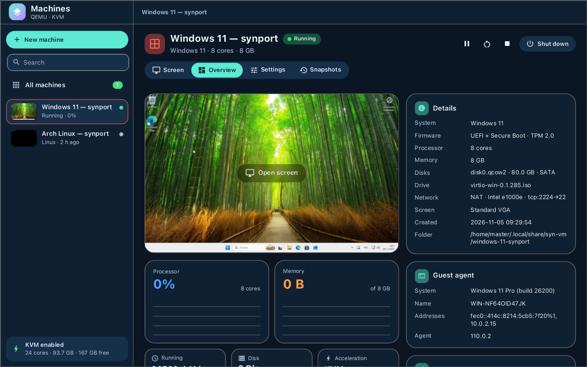
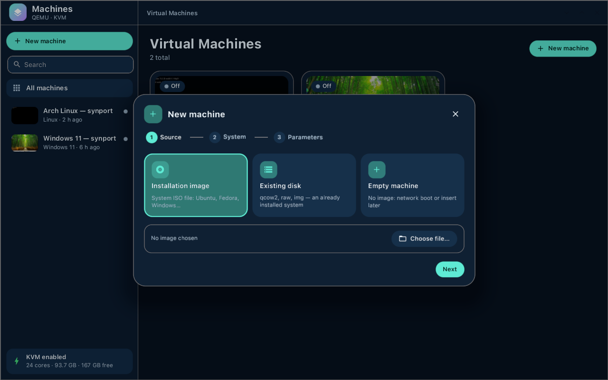
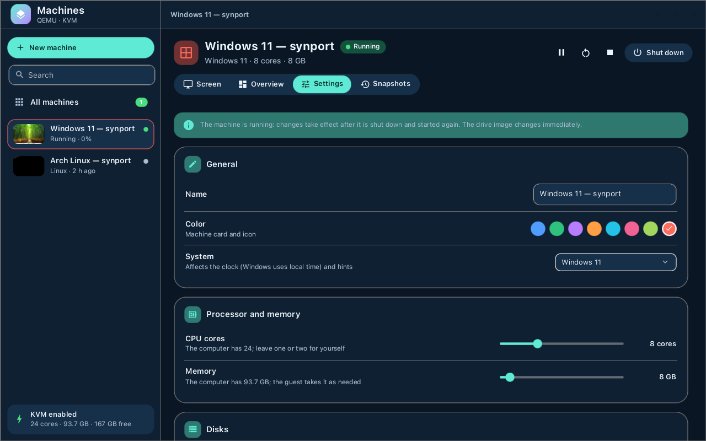
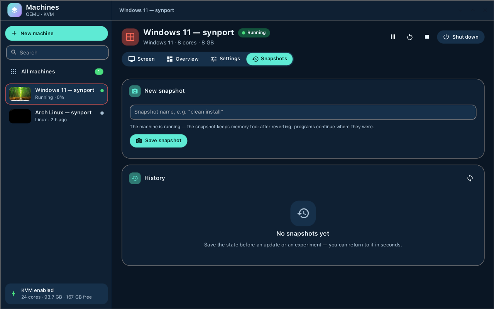

<div align="center">

# syn-vm

**Virtual machines for the synshell desktop — QEMU/KVM with a native UI, a scriptable CLI and an MCP server for AI agents.**

[Русский](README.ru.md) · [Website](https://alexeyev.dev/syndesktop/) · [AUR: syn-vm-bin](https://aur.archlinux.org/packages/syn-vm-bin) · [AUR: syn-vm-git](https://aur.archlinux.org/packages/syn-vm-git)



</div>

## Features

- **Wizard** — create a machine from an ISO, import an existing disk (qcow2/raw/img, UEFI variables and TPM are copied), or start empty; presets for Linux, Windows 11/10, BSD, Android.
- **Windows 11 ready** — UEFI + Secure Boot, TPM 2.0 (swtpm), virtio-win «Guest Tools» disc in one click.
- **Built-in display** — the guest screen right in the window, clipboard and input; live thumbnails in the machine list.
- **Snapshots** — create, restore and delete; USB devices are replugged after a restore.
- **Device passthrough** — PCI (VFIO, returned to the host on shutdown), USB **by physical port** (a phone that goes Android → fastboot → recovery stays with the guest), input devices, whole disks, serial ports, host TPM, PipeWire audio.
- **Shared folders** — virtiofs or SMB.
- **Guest agent** — run commands, copy files, sync the clock, see the guest OS, addresses and ports (qemu-ga; Windows output is converted to UTF-8).
- **Screen recording** — the guest screen at native resolution with a steady frame rate (NVENC / VAAPI / x264).
- **CLI for scripts** — everything the window can do, plus screenshots, typing, keys and clicks without a window.
- **MCP server** — let an AI agent drive your VMs: `claude mcp add syn-vm -- syn-vm --mcp`.
- **14 languages** — the UI follows the system or the language chosen in the app.

| Wizard | Settings | Snapshots |
|---|---|---|
|  |  |  |

<!-- Video: replace with the YouTube link when it is published.
[](https://youtube.com/watch?v=…)
-->

## Install

**Arch Linux (AUR)** — x86_64 and aarch64:

```sh
yay -S syn-vm-bin      # prebuilt
yay -S syn-vm-git      # built from source
```

Optional: `qemu-desktop` (the machines themselves), `edk2-ovmf` (UEFI), `swtpm` (TPM for Windows 11), `virtiofsd` or `samba` (shared folders), `virtio-win` (Windows drivers and guest agent).

The whole desktop: `yay -S synshell-bin`. **From source:** `cargo build --release -p syn-vm` in the [synshell](../../README.md) repository.

## Command line

```sh
syn-vm --list                                   # machines and their state
syn-vm --new arch --iso archlinux.iso --os linux --memory 8192 --disk-gb 40
syn-vm --start arch --wait-boot                 # start headless, wait for the guest agent
syn-vm --sh arch 'uname -a'                     # run in the guest
syn-vm --push arch ./file.txt /root/file.txt    # copy a file in
syn-vm --usb arch attach 3-1                    # give USB port 3-1 to the guest, live
syn-vm --snapshot arch create before-update
syn-vm --record arch demo.mp4 --duration 30     # record the guest screen
syn-vm --screendump arch frame.png
syn-vm --help                                   # everything else
```

## Part of synshell

syn-vm is one of the applications of [synshell](../../README.md) — a Wayland desktop environment in Rust for computers and phones, built on the [syngui](https://github.com/VitaminDB/syngui) UI framework.

## License

GPL-3.0-only
