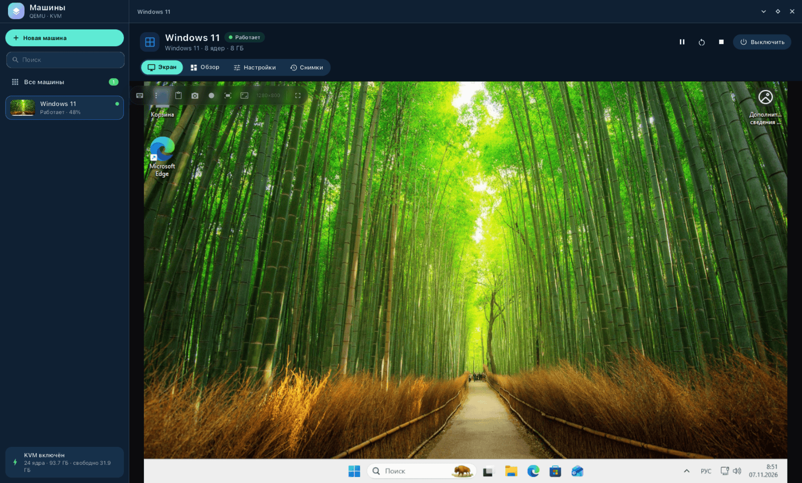
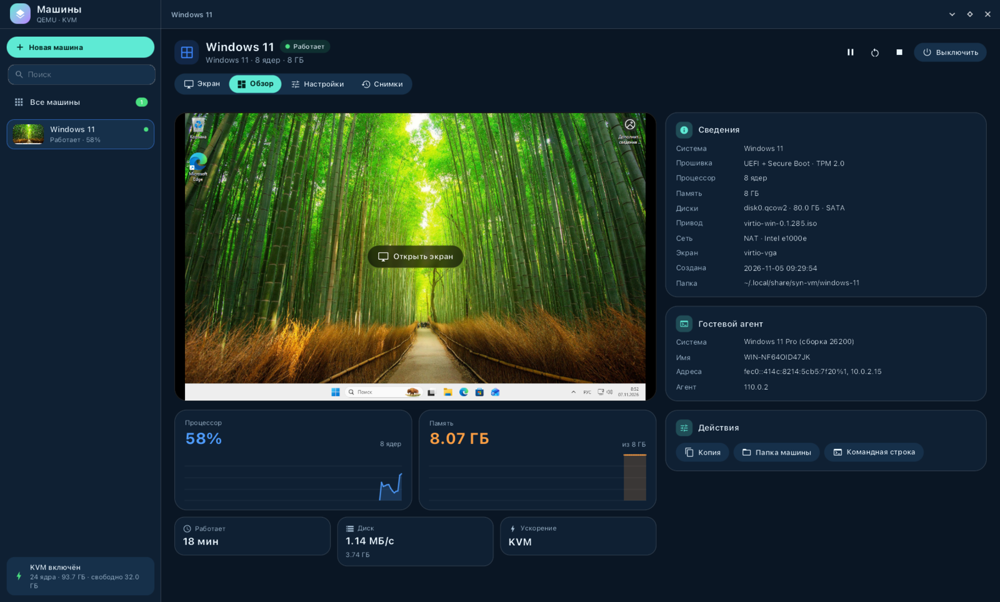
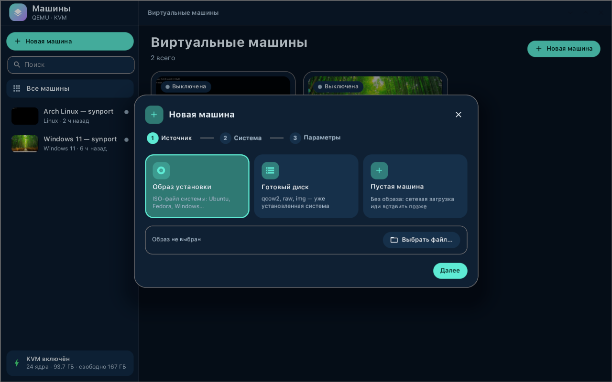
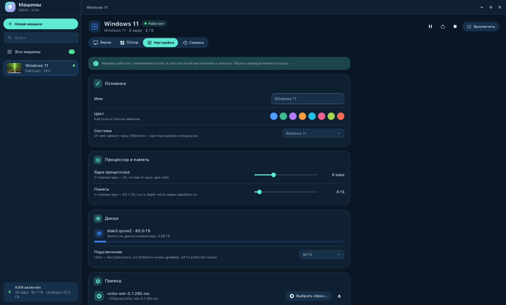
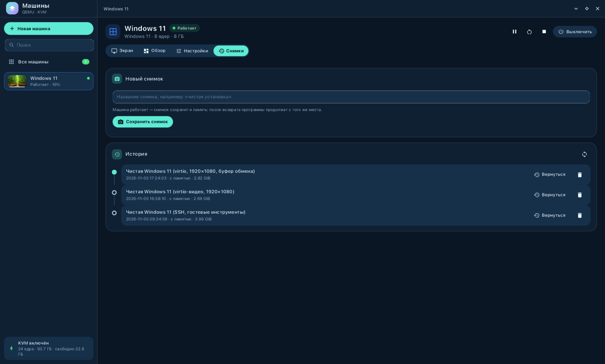

<div align="center">

# syn-vm

**Виртуальные машины рабочего стола synshell — QEMU/KVM с родным интерфейсом, командной строкой для скриптов и MCP-сервером для ИИ-агентов.**

[English](README.md) · [Сайт](https://alexeyev.dev/ru/synshell/syn-vm/) · [AUR: syn-vm-bin](https://aur.archlinux.org/packages/syn-vm-bin) · [AUR: syn-vm-git](https://aur.archlinux.org/packages/syn-vm-git)



</div>

## Возможности

- **Мастер** — машина из ISO, импорт готового диска (qcow2/raw/img; переменные UEFI и TPM копируются) или пустая; заготовки для Linux, Windows 11/10, BSD, Android.
- **Готово для Windows 11** — UEFI + Secure Boot, TPM 2.0 (swtpm), «Гостевые инструменты syn-vm» одной кнопкой: свой агент, свой драйвер virtio-serial и драйвер видеокарты syn-gpu (или по-старому virtio-win).
- **Встроенный экран** — экран гостя прямо в окне, ввод, разрешение гостя под окно, буфер обмена с текстом и картинками в обе стороны; живые миниатюры в списке машин.
- **3D-графика (syn-gpu)** — Vulkan и DirectX (через DXVK) в Windows-гостях считаются на видеокарте компьютера; видеокарта компьютера и видеопамять гостя выбираются в настройках; кадры игр — прямо в окно.
- **Снимки** — создать, вернуть, удалить; USB-устройства после возврата переподключаются.
- **Проброс устройств** — PCI (VFIO, возвращается компьютеру при выключении), USB **по физическому порту** (телефон, который уходит Android → fastboot → recovery, остаётся у гостя), устройства ввода, диски целиком, последовательные порты, TPM компьютера, звук PipeWire.
- **Общие папки** — несколько у одной машины: virtiofs, 9p или SMB; в Windows подключаются дисками Z:, Y:…, в Linux — в /mnt/hostshare…
- **Свой гостевой агент** (syn-vm-agent, Windows и Linux) — команды с потоковым выводом и тайм-аутом, в том числе в сеансе вошедшего пользователя, файлы и каталоги со сверкой SHA-256, часы по хосту, журналы гостя на хосте (`--agent-log`); у старых машин — qemu-ga.
- **Запись экрана** — экран гостя в родном разрешении с ровной частотой кадров (NVENC / VAAPI / x264).
- **Командная строка** — всё, что умеет окно, и ещё снимки экрана, ввод текста, клавиши и щелчки без окна.
- **MCP-сервер** — ИИ-агент управляет машинами: `claude mcp add syn-vm -- syn-vm --mcp`.
- **14 языков** — как в системе или свой язык в настройках приложения.

| Обзор | Мастер |
|---|---|
|  |  |

| Настройки | Снимки |
|---|---|
|  |  |

<!-- Видео: ссылка на YouTube — когда будет опубликовано.
[](https://youtube.com/watch?v=…)
-->

## Установка

**Arch Linux (AUR)** — x86_64 и aarch64:

```sh
yay -S syn-vm-bin      # готовые бинарники
yay -S syn-vm-git      # сборка из исходников
```

Дополнительно: `qemu-desktop` (сами машины), `edk2-ovmf` (UEFI), `swtpm` (TPM для Windows 11), `virtiofsd` или `samba` (общие папки), `libisoburn` (диск «Гостевые инструменты syn-vm»), `virtio-win` (по желанию: драйверы virtio-win для Windows).

Весь рабочий стол: `yay -S synshell-bin`. **Из исходников:** `cargo build --release -p syn-vm` в репозитории [synshell](../../README.md).

## Командная строка

```sh
syn-vm --list                                   # машины и их состояние
syn-vm --new arch --iso archlinux.iso --os linux --memory 8192 --disk-gb 40
syn-vm --start arch --wait-boot                 # запуск без окна, ждать гостевого агента
syn-vm --sh arch 'uname -a'                     # команда в госте
syn-vm --push arch ./file.txt /root/file.txt    # файл в гостя
syn-vm --exec win11 --user -- notepad.exe       # в сеансе вошедшего пользователя
syn-vm --agent-log win11 --follow               # журналы гостя
syn-vm --tools win11 install                    # «Гостевые инструменты syn-vm»
syn-vm --usb arch attach 3-1                    # USB-порт 3-1 гостю на ходу
syn-vm --snapshot arch create before-update
syn-vm --record arch demo.mp4 --duration 30     # запись экрана гостя
syn-vm --screendump arch frame.png
syn-vm --help                                   # остальное
```

## Часть synshell

syn-vm — одно из приложений [synshell](../../README.md): окружения рабочего стола для Wayland на Rust для компьютеров и телефонов, на UI-фреймворке [syngui](https://github.com/VitaminDB/syngui).

## Лицензия

GPL-3.0-only
