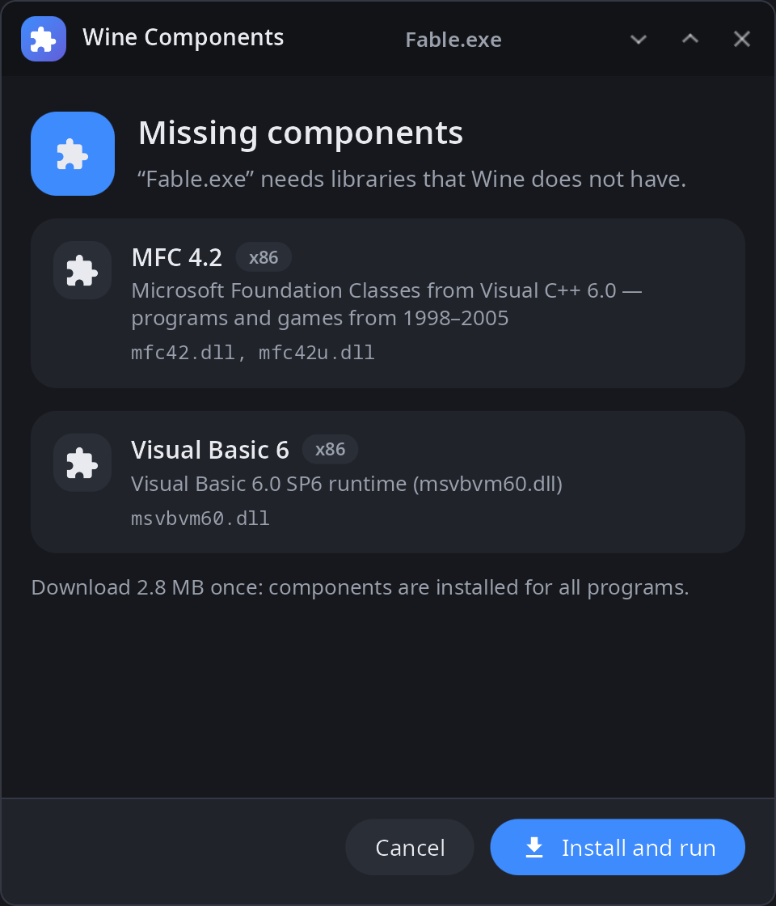
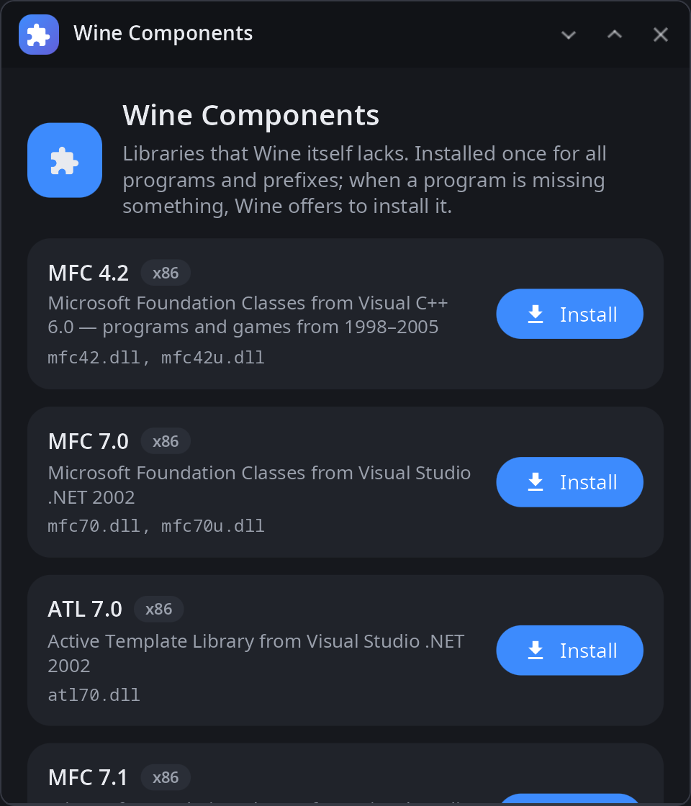
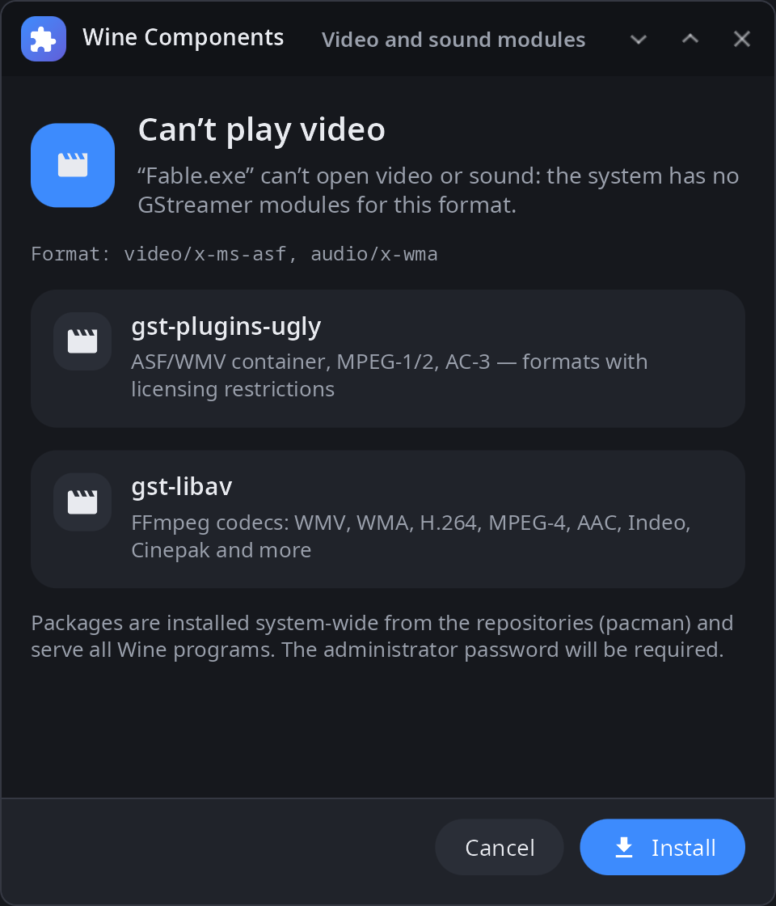

<div align="center">

# syn-wine-helper

**Wine components for the synshell desktop — DLLs that Wine itself does not have (MFC, Visual Basic runtimes, OpenAL), installed once for all prefixes and offered when a program needs them.**

[Русский](README.ru.md) · [Website](https://alexeyev.dev/syndesktop/) · [AUR: syn-wine-helper-bin](https://aur.archlinux.org/packages/syn-wine-helper-bin) · [AUR: syn-wine-helper-git](https://aur.archlinux.org/packages/syn-wine-helper-git)



</div>

## Features

- **Components** — MFC 4.2 to MFC 14, ATL 7.0, C++ 2022 threads, Visual Basic 5 and 6 runtimes, OpenAL Soft; x86 and x64 where available.
- **One copy for all prefixes** — DLLs go to `$XDG_DATA_HOME/syn-wine/dlls`, not into each Wine prefix.
- **Asked when needed** — when a program fails to start because of a missing DLL, Wine calls the helper: a window lists what is missing, installs it and starts the program again.
- **Video and audio codecs** — when a program cannot play a video or sound format, the window offers the GStreamer packages that handle it (installed with pacman, administrator password required).
- **From the original redistributables** — files are downloaded from the vendors' installers, checked by SHA-256 and unpacked by the helper itself (CAB, MSI, NSIS, ZIP); nothing extra has to be installed.
- **Check without running** — `scan` reads a program's imports and tells which DLLs are missing and which package has them.
- **Own packages** — add or replace entries in `$XDG_DATA_HOME/syn-wine/packages.toml`.
- **14 languages** — the UI follows the system language.

| Components | Video and audio |
|---|---|
|  |  |

Automatic questions about missing DLLs and codecs need synshell's own Wine build (`crates/syn-wine`), which also looks for DLLs in the shared directory.

## Install

**Arch Linux (AUR)** — x86_64 and aarch64:

```sh
yay -S syn-wine-helper-bin      # prebuilt
yay -S syn-wine-helper-git      # built from source
```

The whole desktop: `yay -S synshell-bin`. **From source:** `cargo build --release -p syn-wine-helper` in the [synshell](../../README.md) repository.

## Command line

```sh
syn-wine-helper                           # window with the list of components
syn-wine-helper list                      # packages and what is installed
syn-wine-helper install mfc42 vb6run      # by package id or DLL name
syn-wine-helper install msvbvm60.dll --arch x86
syn-wine-helper remove mfc42
syn-wine-helper scan Game.exe             # which DLLs would be missing
syn-wine-helper run Game.exe              # check, offer what is missing, start in Wine
syn-wine-helper probe setup.exe           # which DLLs are inside an installer
```

## Part of synshell

syn-wine-helper is one of the applications of [synshell](../../README.md) — a Wayland desktop environment in Rust for computers and phones, built on the [syngui](https://github.com/VitaminDB/syngui) UI framework.

## License

GPL-3.0-only
