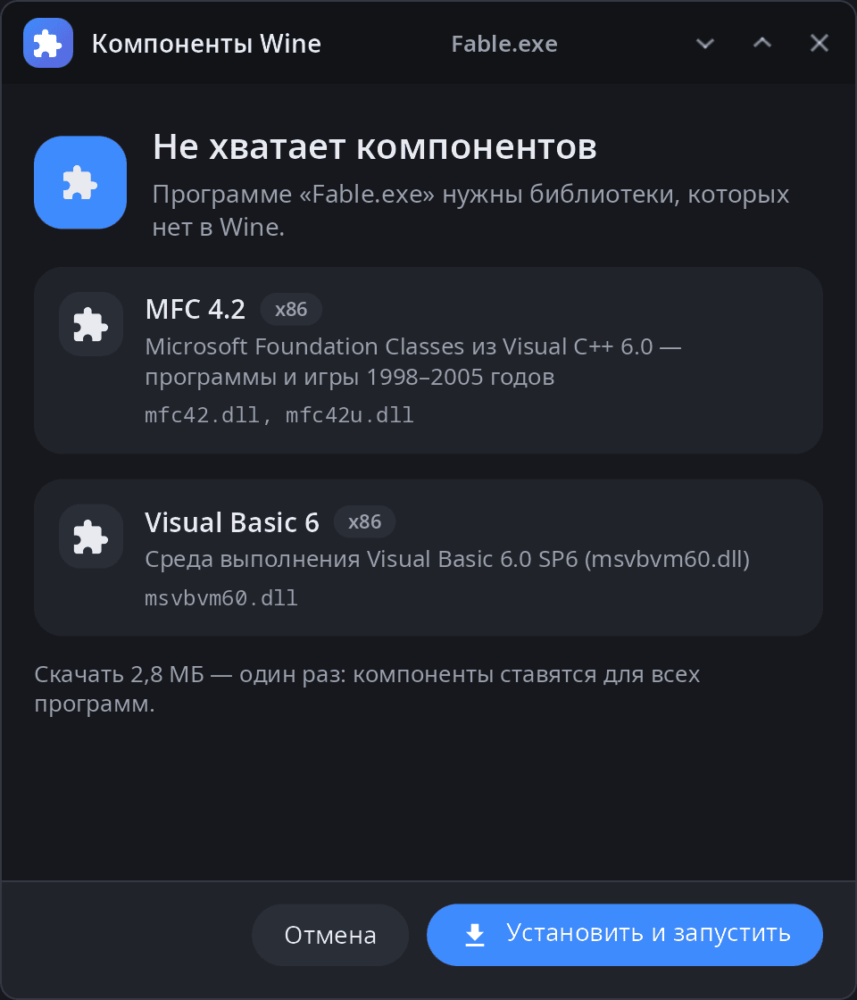
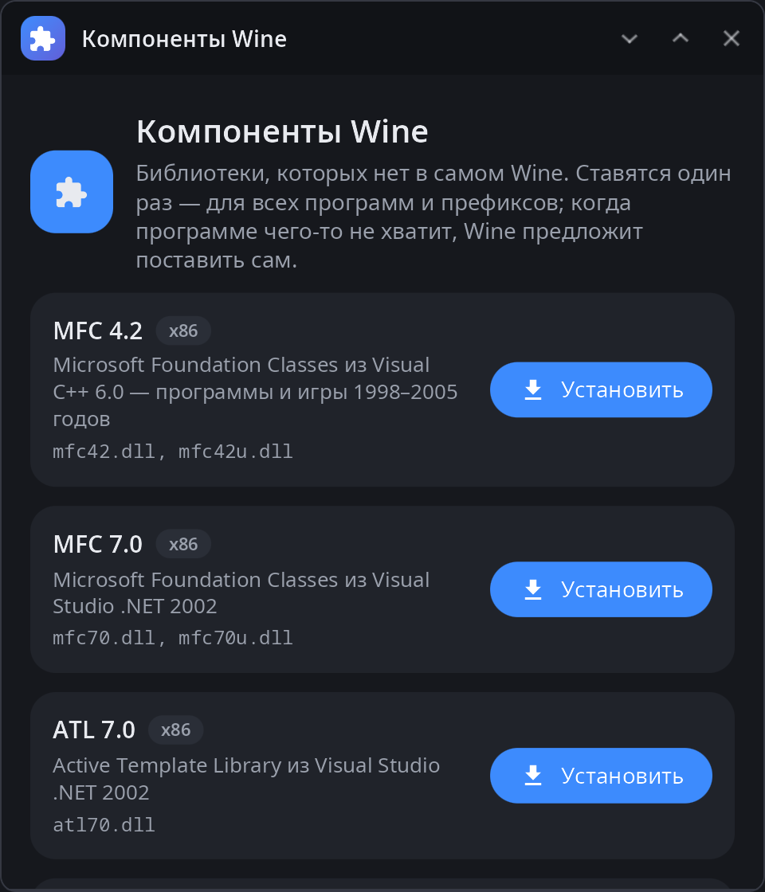
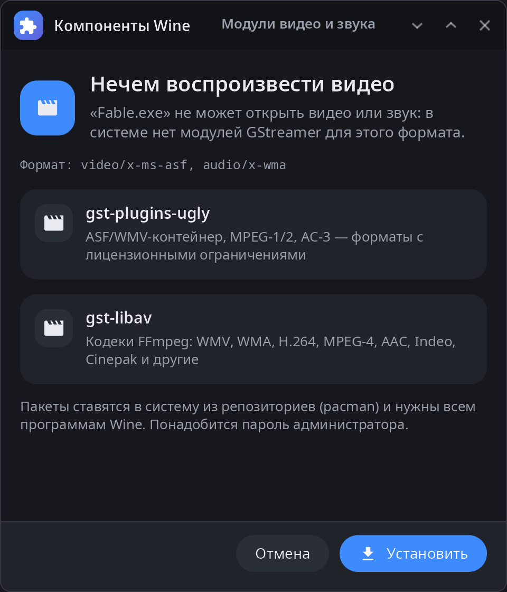

<div align="center">

# syn-wine-helper

**Компоненты Wine рабочего стола synshell — DLL, которых нет в самом Wine (MFC, рантаймы Visual Basic, OpenAL): ставятся один раз для всех префиксов и предлагаются, когда программе их не хватает.**

[English](README.md) · [Сайт](https://alexeyev.dev/ru/synshell/syn-wine-helper/) · [AUR: syn-wine-helper-bin](https://aur.archlinux.org/packages/syn-wine-helper-bin) · [AUR: syn-wine-helper-git](https://aur.archlinux.org/packages/syn-wine-helper-git)



</div>

## Возможности

- **Компоненты** — MFC от 4.2 до 14, ATL 7.0, потоки C++ 2022, рантаймы Visual Basic 5 и 6, OpenAL Soft; x86 и x64, где они есть.
- **Одна копия для всех префиксов** — DLL кладутся в `$XDG_DATA_HOME/syn-wine/dlls`, а не в каждый префикс Wine.
- **Вопрос, когда нужно** — если программа не запускается из-за недостающей DLL, Wine зовёт помощника: окно показывает, чего не хватает, ставит это и запускает программу снова.
- **Кодеки видео и звука** — если программе нечем воспроизвести формат видео или звука, окно предлагает пакеты GStreamer для него (ставятся через pacman, нужен пароль администратора).
- **Из оригинальных установщиков** — файлы скачиваются из установщиков производителей, сверяются по SHA-256 и распаковываются самим помощником (CAB, MSI, NSIS, ZIP); ничего дополнительно ставить не нужно.
- **Проверка без запуска** — `scan` читает импорт программы и говорит, каких DLL не хватит и в каком пакете они есть.
- **Свои пакеты** — можно добавить или заменить записи в `$XDG_DATA_HOME/syn-wine/packages.toml`.
- **14 языков** — интерфейс на языке системы.

| Компоненты | Видео и звук |
|---|---|
|  |  |

Вопросы о недостающих DLL и кодеках задаёт только свой Wine synshell (`crates/syn-wine`): он же ищет DLL в общем каталоге.

## Установка

**Arch Linux (AUR)** — x86_64 и aarch64:

```sh
yay -S syn-wine-helper-bin      # готовые бинарники
yay -S syn-wine-helper-git      # сборка из исходников
```

Весь рабочий стол: `yay -S synshell-bin`. **Из исходников:** `cargo build --release -p syn-wine-helper` в репозитории [synshell](../../README.md).

## Командная строка

```sh
syn-wine-helper                           # окно со списком компонентов
syn-wine-helper list                      # пакеты и что установлено
syn-wine-helper install mfc42 vb6run      # по id пакета или имени DLL
syn-wine-helper install msvbvm60.dll --arch x86
syn-wine-helper remove mfc42
syn-wine-helper scan Game.exe             # каких DLL не хватит
syn-wine-helper run Game.exe              # проверить, предложить недостающее, запустить в Wine
syn-wine-helper probe setup.exe           # какие DLL есть внутри установщика
```

## Часть synshell

syn-wine-helper — одно из приложений [synshell](../../README.md): окружения рабочего стола для Wayland на Rust для компьютеров и телефонов, на UI-фреймворке [syngui](https://github.com/VitaminDB/syngui).

## Лицензия

GPL-3.0-only
