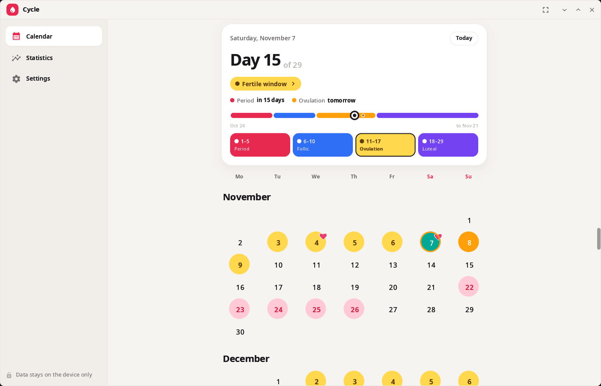
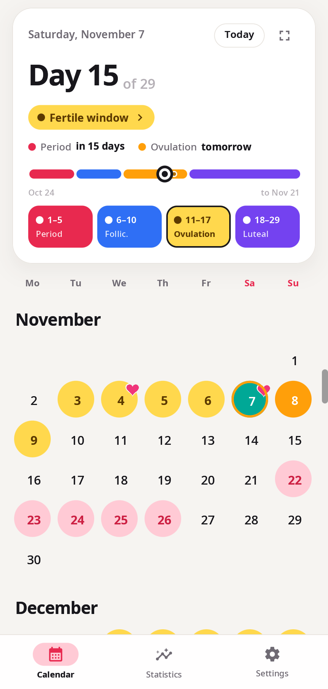
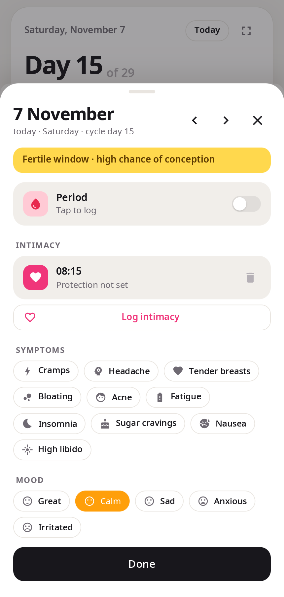
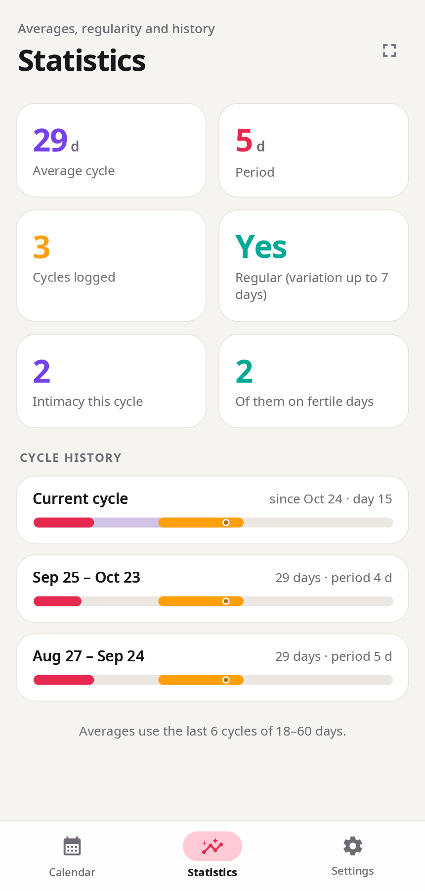

<div align="center">

# syn-woman-cycle

**Cycle tracker for the synshell desktop — periods, fertile window and ovulation, symptoms and mood; the data stays on the device.**

[Русский](README.ru.md) · [Website](https://alexeyev.dev/synshell/) · [AUR: syn-woman-cycle-bin](https://aur.archlinux.org/packages/syn-woman-cycle-bin) · [AUR: syn-woman-cycle-git](https://aur.archlinux.org/packages/syn-woman-cycle-git)



</div>

## Features

- **Calendar** — months in one scrolling ribbon; tap a date to mark the start of a period, a period day, ovulation (for example, from a test) or intimacy.
- **Cycle card** — the day of the cycle, the current phase (period, follicular, fertile window, luteal) on a bar with dates, and how many days are left until the next period and ovulation; each phase has a short description.
- **Forecast** — next periods, fertile window and ovulation from your history (averages of the last 6 cycles) or from the lengths you set; a manually marked ovulation replaces the calculated one for that cycle. The forecast is an estimate: it is not medical advice and not a method of contraception.
- **Day card** — flow (spotting to heavy), ten symptoms, mood, intimacy with time and protection.
- **Statistics** — average cycle and period length, regularity, intimacy in this cycle and on fertile days, history of cycles with their phases.
- **Privacy** — no account and no network: everything is kept in `~/.local/share/synshell/woman-cycle/data.json`. Intimacy marks can be hidden from the calendar; all marks can be deleted in one go.
- **Look** — light, dark or system theme, six designs (classic, sakura, berry, lavender, daisy, starry night), week starting on Monday or Sunday, interface scale, full screen.
- **Phone and desktop** — bottom navigation on narrow screens, a sidebar on wide ones.
- **14 languages** — the UI follows the system language.

| Calendar | Day | Statistics |
|---|---|---|
|  |  |  |

The screenshots show made-up sample data.

## Install

**Arch Linux (AUR)** — x86_64 and aarch64:

```sh
yay -S syn-woman-cycle-bin      # prebuilt
yay -S syn-woman-cycle-git      # built from source
```

The whole desktop: `yay -S synshell-bin`. **From source:** `cargo build --release -p syn-woman-cycle` in the [synshell](../../README.md) repository.

## Command line

```sh
syn-woman-cycle                                   # open the app
syn-woman-cycle --screenshot cal.png --page calendar --size 430x900 --scale 2   # screenshot with sample data
syn-woman-cycle --help
```

`--page` takes `calendar`, `day`, `history`, `settings`, `menu`, `intro`, `phase-period|folli|fert|lute`; `--dark` and `--decor NAME` change the look.

## Part of synshell

syn-woman-cycle is one of the applications of [synshell](../../README.md) — a Wayland desktop environment in Rust for computers and phones, built on the [syngui](https://github.com/VitaminDB/syngui) UI framework.

## License

GPL-3.0-only
