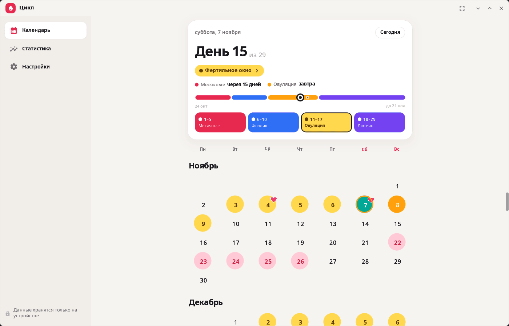
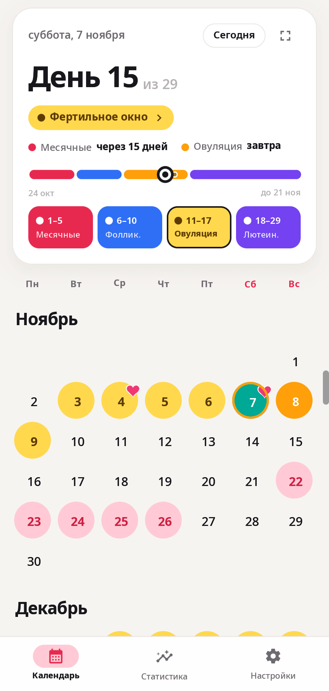
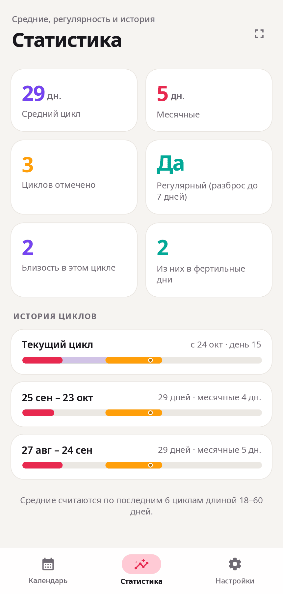

<div align="center">

# syn-woman-cycle

**Женский календарь рабочего стола synshell — месячные, фертильное окно и овуляция, самочувствие и настроение; данные остаются на устройстве.**

[English](README.md) · [Сайт](https://alexeyev.dev/ru/synshell/syn-woman-cycle/) · [AUR: syn-woman-cycle-bin](https://aur.archlinux.org/packages/syn-woman-cycle-bin) · [AUR: syn-woman-cycle-git](https://aur.archlinux.org/packages/syn-woman-cycle-git)



</div>

## Возможности

- **Календарь** — месяцы одной лентой; нажатие на дату — отметить начало месячных, день месячных, овуляцию (например, по тесту) или близость.
- **Карточка цикла** — день цикла, текущая фаза (месячные, фолликулярная, фертильное окно, лютеиновая) на полосе с датами, сколько дней до месячных и до овуляции; у каждой фазы — короткое описание.
- **Прогноз** — следующие месячные, фертильное окно и овуляция по истории (средние последних 6 циклов) или по заданным длинам; отмеченная вручную овуляция заменяет расчётную в своём цикле. Прогноз — оценка: это не медицинский совет и не способ контрацепции.
- **Карточка дня** — обильность (от мажущих до обильных), десять симптомов, настроение, близость со временем и защитой.
- **Статистика** — средняя длина цикла и месячных, регулярность, близость в этом цикле и в фертильные дни, история циклов с фазами.
- **Приватность** — без учётной записи и без сети: всё хранится в `~/.local/share/synshell/woman-cycle/data.json`. Отметки близости можно скрыть из календаря, все отметки — удалить разом.
- **Вид** — светлая, тёмная или системная тема, шесть оформлений («Классика», «Сакура», «Ягодка», «Лаванда», «Ромашки», «Звёздная ночь»), неделя с понедельника или с воскресенья, масштаб интерфейса, полноэкранный режим.
- **Телефон и компьютер** — на узком экране навигация внизу, на широком — боковая панель.
- **14 языков** — интерфейс на языке системы.

| Календарь | День | Статистика |
|---|---|---|
|  |  |  |

На снимках — придуманные данные.

## Установка

**Arch Linux (AUR)** — x86_64 и aarch64:

```sh
yay -S syn-woman-cycle-bin      # готовые бинарники
yay -S syn-woman-cycle-git      # сборка из исходников
```

Весь рабочий стол: `yay -S synshell-bin`. **Из исходников:** `cargo build --release -p syn-woman-cycle` в репозитории [synshell](../../README.md).

## Командная строка

```sh
syn-woman-cycle                                   # открыть программу
syn-woman-cycle --screenshot cal.png --page calendar --size 430x900 --scale 2   # снимок на примере
syn-woman-cycle --help
```

`--page` — `calendar`, `day`, `history`, `settings`, `menu`, `intro`, `phase-period|folli|fert|lute`; `--dark` и `--decor ИМЯ` меняют вид.

## Часть synshell

syn-woman-cycle — одно из приложений [synshell](../../README.md): окружения рабочего стола для Wayland на Rust для компьютеров и телефонов, на UI-фреймворке [syngui](https://github.com/VitaminDB/syngui).

## Лицензия

GPL-3.0-only
